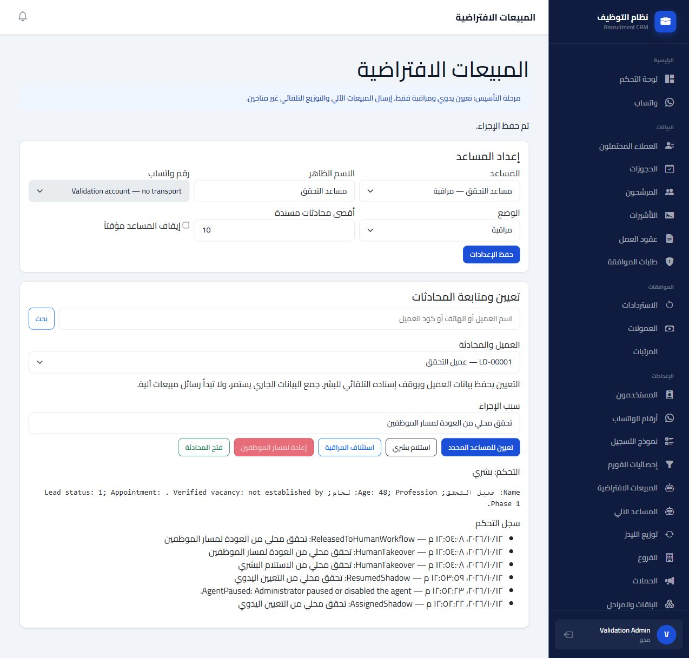

# Phase 1 validation — 12 October 2026

Result: local validation passed. Validation used a disposable PostgreSQL database with synthetic records and a loopback-only browser host. No staging address or sanitized installation backup was supplied; historical drift in an existing installation and live WhatsApp delivery remain unvalidated.

| Check | Result |
| --- | --- |
| Automated PostgreSQL and HTTP integration tests | 20 passed, 0 failed |
| Migration Down/Up rehearsal | Human owner and data retained in disposable database |
| EF migration/model consistency | No pending changes |
| Release publish | Succeeded; five existing warnings |
| Production publish contents | Browser validation host and tests excluded |
| Diff whitespace check | Passed |
| Browser agent creation and manual assignment | Passed |
| Browser pause, unpause, explicit resume | Passed |
| Browser takeover, handoff summary, release | Passed |
| Database state after browser release | Original human owns lead/chat; AI owner columns cleared |
| Customer data after browser flow | Name, age 48, profession retained |
| Audit sequence | AssignedShadow → AgentPaused → ResumedShadow → HumanTakeover → HumanTakeover → ReleasedToHumanWorkflow; versions 1–6 |

The browser check found and fixed a stale conversation display after changing agent settings. Saving settings now refreshes the selected conversation control and ownership version. Action guarding is scoped to the AI Sales page so it does not disable unrelated layout buttons.



## Reproducing the browser check

`Tests/BrowserHost` runs the real compiled Razor page and JavaScript against a newly generated test database. It binds only `127.0.0.1:5189`, clears application configuration, and registers no background workers or outbound WhatsApp transport. Its synthetic login exists only in this separate validation executable, which is excluded from application publishing.

With the dedicated PostgreSQL test cluster running:

```powershell
$env:AI_SALES_TEST_DATABASE = 'Host=127.0.0.1;Port=55439;Username=phase1_test;Database=postgres'
dotnet run --project Tests/BrowserHost/BrowserHost.csproj -- 'C:\Users\hadel\source\repos\RecruitmentSaaS\RecruitmentSaaS'
```

Visit `http://127.0.0.1:5189/validation/login`. Create a Shadow agent, unpause it, manually assign the synthetic customer, pause it, unpause and explicitly resume, take over, then release. Confirm the control display and audit after each action.

Stop gracefully with `Invoke-RestMethod -Method Post http://127.0.0.1:5189/validation/stop`; shutdown removes that executable's disposable database. A forced process termination may require removing the exact generated `phase1_*` database printed by that run, using the dedicated local test instance only.

Next deployment gate: rehearse the migration on a sanitized copy of the actual installation, then verify the approved staging deployment and provider configuration before a live pilot.
