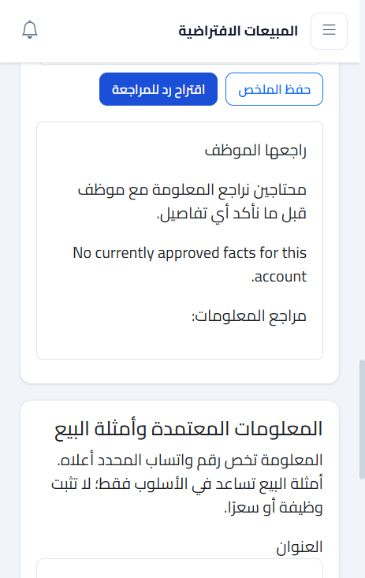

# Phase 2 draft workflow validation — 12 October 2026

Validated locally against synthetic PostgreSQL records. All external model responses in integration tests were mocked. The browser host used the local fallback and had external processing disabled.

| Check | Result |
| --- | --- |
| Foundation plus engine integration/contract suite | 32 passed, 0 failed |
| Build | Passed; five pre-existing warnings |
| Migration/model consistency | No pending model changes |
| Empty foundation/engine rollback and reapply | Passed in disposable database; human data retained |
| Browser knowledge creation and approval | Passed |
| Browser draft generation and human review | Local fallback passed |
| Memory-change stale warning | Passed |
| Empty conversation selection | Clears prior memory/draft panel |
| External processing disabled | No provider call; safe failure displayed |
| Human takeover during provider request | Draft discarded; takeover completes |
| Usage of discarded proposal | Retained when reported by mocked provider |
| Source/tenant/account boundaries | Expired, unapproved and unrelated facts excluded |
| Changed CRM fields / inactive account | Stale draft / new generation rejected |
| Existing customer messages and CRM fields | No generated outgoing message or model-driven mutation |

See [implementation and setup](../ai-sales-phase2-drafts.md) for configuration, limits, privacy, migration and rollback details. An approved staging model/key and synthetic evaluation set are still needed for real model quality, latency and cost measurements. Shared-database tenant isolation, live WhatsApp sending and an existing installation's historical schema drift were not validated.
